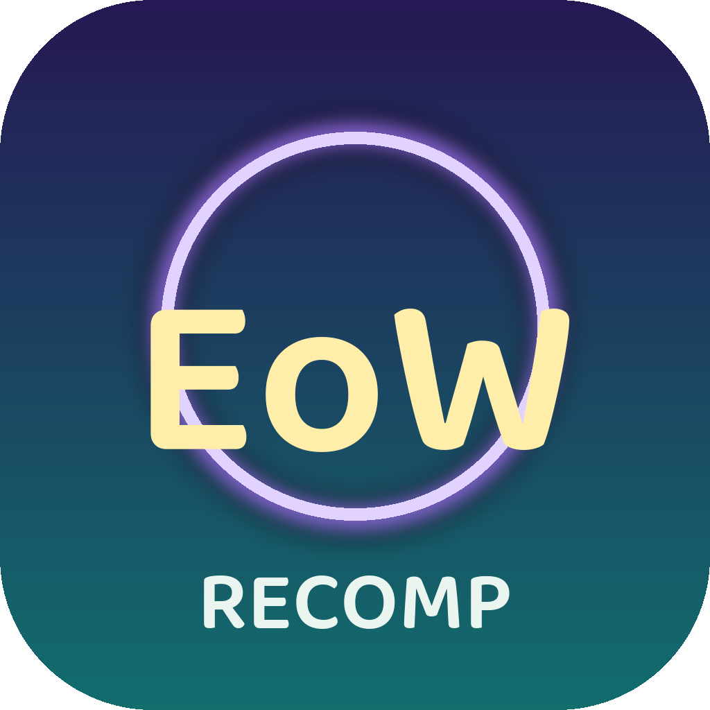
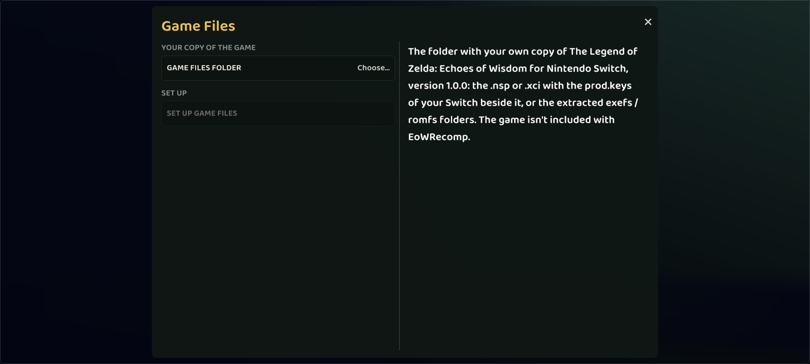

  

<h1 align="center">EoWRecomp</h1>

  <b>A static recompilation of <i>The Legend of Zelda: Echoes of Wisdom</i> (Nintendo Switch, 2024)</b> 
  native code for macOS (Apple Silicon), Linux, Windows and Android - not an emulator

  
  
  
  
  

---

The game's ARM64 machine code is translated to C **ahead of time** and compiled for the machine it runs on; a runtime
replaces the Switch's operating system (Horizon) and its graphics API (NVN), drawing with Vulkan. Built on
[LAS Recomp](https://github.com/peiikai/LASRecomp), the same kind of project for *Link's Awakening* (also by Grezzo),
and on its Android port [LASRecomp-Android-Plus](https://github.com/Nycolazs/LASRecomp-Android-Plus).

> [!WARNING]
> **Early development - not fully playable yet.** The game boots, plays its opening and the first controllable scene
> with working input (Linux / Vulkan). The macOS and Android builds start, set the game up from your own package and
> are tested without the game; running the game on them is the next step. See [docs/STATUS.md](docs/STATUS.md).

> [!IMPORTANT]
> **No game files are included**, and none ever will be - not in this repository, not in any build. EoWRecomp needs
> your own legally obtained copy of *Echoes of Wisdom* **v1.0.0** (title `01008CF01BAAC000`, no update) and the
> `prod.keys` of your own console. Instructions on how to obtain them will **not** be provided.

## Screenshots

Frames of the recompiled game itself, captured by the runtime (native Linux build, Vulkan, 1280x720).

| | |
|---|---|
|  |  |
|  |  |

   
  The Android app (alpha 1): setting the game up from your own files.

## Download

**[Latest release](https://github.com/Nycolazs/EoWRecomp/releases/latest)** - *alpha 1, a preview: the start screen and
the game setup, not the game yet* (see the warning above).

| | File | Needs |
|---|---|---|
| **macOS** | `EoWRecomp-alpha_1-macOS-arm64.zip` | Apple Silicon (M1 or later), macOS 15+. Not notarized: the first time, right-click the app -> **Open**. |
| **Android** | `EoWRecomp-alpha_1-Android-arm64.apk` | arm64 phone, Android 11+, Vulkan 1.3. Builds the game code on the phone from your files. |

Neither contains anything from the game: you choose the folder with your own `.nsp` / `.xci` and `prod.keys`, and the
game code is recompiled on your device. Checksums: `SHA256SUMS.txt` in the release.

## Features

- **Set up from your own package**: choose the folder with your `.nsp` / `.xci` and `prod.keys`. Only the game's code
  (~40 MB) is written out; the 7.5 GB of game data is read **straight from your package**, decrypted and decompressed
  on the fly ([runtime/nxpkg.c](runtime/nxpkg.c)) - no second copy of the game on your disk or phone.
- **Built on your machine**: the start screen recompiles the game code locally (generator + bundled `zig` compiler);
  nothing derived from the game is ever distributed.
- **One renderer everywhere**: NVN reimplemented on Vulkan - natively on Linux / Windows / Android, through
  [MoltenVK](https://github.com/KhronosGroup/MoltenVK) on Apple Silicon. The game's Maxwell GPU shaders are translated
  to GLSL at run time (and tested against Metal's compiler for MoltenVK).
- **Android**: touch controls with every Switch button, controllers, a pre-rotated swapchain (no compositor rotation
  pass), Android performance hints, and the game code built on the phone itself (Python + clang inside the APK).
- Upscaling (AMD FSR 1), SMAA, unlocked aspect ratio, control remapping, in-game settings menu (`F1` / `Esc`).

## Platforms

| | Build | Start screen & setup | The game |
|---|---|---|---|
| **Linux** (x86-64) | ✅ | ✅ | ✅ opening + first scene (Vulkan, Intel Iris Xe) |
| **macOS** (Apple Silicon, 15+) | ✅ `.app` with MoltenVK | ✅ tested on an M1 | ⏳ next |
| **Android** (arm64, Vulkan 1.3) | ✅ APK | ✅ tested on the Android 15 emulator | ⏳ next |
| **Windows** (x86-64) | ✅ cross-compiled from Linux | - | untested |

## Progress

| Milestone | State |
|---|---|
| M1 - all game code recompiles to C (4 modules, ~296,000 functions, 0 unsupported instructions) | ✅ |
| M2 - the runtime links and boots into the game | ✅ |
| M3 - first frame presented | ✅ |
| M4 - first correct image | ✅ the opening |
| M5 - title screen, audio, input, new game, first playable scene | 🔶 input works, first scene reachable |
| M6 - playable start to finish, saves | ⬜ |
| M7 - PC features: resolution, free aspect ratio, unlocked frame rate, remapping, button icons | ⬜ |

## Building

- **macOS** (Apple Silicon): [docs/BUILD-macos.md](docs/BUILD-macos.md) - `tools/macos/dev_deps.sh`, `make gen`,
  `make`; `make app` makes the shippable `EoWRecomp.app`.
- **Android**: [docs/BUILD-android.md](docs/BUILD-android.md) - the APK (with or without the on-phone builder) and a
  personal APK with the game code built on your computer.
- **Linux**: `tools/linux/dev_deps.sh`, then `make gen` and
  `PATH=$PWD/build/bin:$PATH make -j$(nproc) DEPS=$PWD/build/deps-linux GENARCH=-mcpu=x86_64_v3`.
- **Windows**: `tools/windows/fetch_deps.sh` and `tools/windows/build.sh all` (cross-compiled from Linux).

Your game files, everywhere: `tools/venv/bin/python -I tools/nca_extract.py <prod.keys> <game.nsp | program.nca>
extracted --no-romfs --romfs-image` - or let the start screen do it.

### Tests that need no game files

| | |
|---|---|
| `tools/test_nxpkg.sh` | the package reader: AES (FIPS-197, SP 800-38A), XTS (IEEE 1619), LZ4 |
| `tools/test_translate.sh` | the Maxwell shader translator: random programs -> GLSL -> SPIR-V, validated |
| `tools/test_moltenvk.sh` | ... on through SPIRV-Cross to MSL, compiled by Metal (MoltenVK's path) |
| `tools/test_lift.py --synth` | the ARM64 lifter against Unicorn, instruction by instruction |
| `tools/test_lse.c` | the ARMv8.1 atomics against the CPU's own instructions (ARM64 hosts) |

## How it works

- **Recompiler** (`tools/`, Python): reads the ExeFS modules (`main`, `sdk`, `subsdk0` - the GLSL compiler,
  `subsdk1` - multimedia), finds every function (`.eh_frame`, symbols, relocations, call targets), resolves jump tables
  by running the code in [Unicorn](https://www.unicorn-engine.org), and emits C for each function. Integer and memory
  instructions become C; FP/SIMD becomes inline assembly on ARM64 hosts or portable C elsewhere. ARMv8.1 atomics and
  128-bit exclusive pairs used by the SDK 16.2 are supported.
- **Runtime** (`runtime/`, C): a small Horizon kernel (threads, mutexes and condition variables with Horizon
  semantics, memory, events), IPC with the system services the game uses (file system, input, audio renderer, applet
  manager, time, settings...), and NVN on top of Vulkan.
- **Packages** (`runtime/nxpkg.c`, `tools/nca_extract.py`): NSP / XCI / NCA with the player's keys, including the
  compressed RomFS this game uses (which hactool can't read).

[docs/ARCHITECTURE.md](docs/ARCHITECTURE.md) explains the pipeline and what was reused, adapted or written new.

## Credits

- **[LAS Recomp](https://github.com/peiikai/LASRecomp)** by Peiikai and its contributors - the base of this project
  (MIT). The recompiler, the Horizon runtime, the NVN implementation, the Maxwell shader translator and the Vulkan
  renderer all started there.
- **[LASRecomp-Android-Plus](https://github.com/Nycolazs/LASRecomp-Android-Plus)** (MIT) - the Android platform
  layer, the on-phone game code build, touch / pre-rotation / performance-hint techniques.
- [SDL 3](https://libsdl.org) (zlib), [FFmpeg](https://ffmpeg.org) (LGPL 2.1+, linked dynamically, LGPL-only build),
  [Dear ImGui](https://github.com/ocornut/imgui) (MIT), [MoltenVK](https://github.com/KhronosGroup/MoltenVK) and the
  [Vulkan loader](https://github.com/KhronosGroup/Vulkan-Loader) (Apache 2.0),
  [volk](https://github.com/zeux/volk) (MIT),
  [Vulkan Memory Allocator](https://github.com/GPUOpen-LibrariesAndSDKs/VulkanMemoryAllocator) (MIT),
  [shaderc](https://github.com/google/shaderc) (Apache 2.0), [SMAA](https://github.com/iryoku/smaa) (MIT),
  [AMD FidelityFX Super Resolution 1](https://github.com/GPUOpen-Effects/FidelityFX-FSR) (MIT),
  [Baloo 2](https://github.com/EkType/Baloo2) (SIL OFL 1.1) and [DejaVu Sans](https://dejavu-fonts.github.io)
  (Bitstream Vera license) fonts
- Build-time and on-phone tools: [Capstone](https://www.capstone-engine.org) (BSD),
  [Unicorn](https://www.unicorn-engine.org) (GPL 2.0; Python bindings BSD), [python-lz4](https://github.com/python-lz4/python-lz4)
  (BSD), [cryptography](https://cryptography.io) (Apache 2.0 / BSD), [CPython](https://www.python.org) (PSF),
  [Zig](https://ziglang.org) as C compiler (MIT; LLVM: Apache 2.0 with LLVM exceptions), Android NDK pieces (Apache 2.0)
- Documentation: [Switchbrew](https://switchbrew.org), [envytools](https://github.com/envytools/envytools),
  Atmosphère's kernel and file system sources, and the instruction decoders of Ryujinx and yuzu as references for
  Maxwell and Horizon behaviour.

This project is developed almost entirely with AI (Anthropic's Claude, through Claude Code), directed and tested by a
human - the same way as the projects it is based on.

## Legal

EoWRecomp is a fan project. It is not affiliated with, endorsed by or sponsored by Nintendo. *The Legend of Zelda* and
*Echoes of Wisdom* are trademarks of Nintendo. No game files, game code, assets, keys or fonts are included - not in
this repository and not in any build. The screenshots above are captures of the running game, shown for documentation.
You must provide your own legally obtained copy of the game.

## License

EoWRecomp's own code is MIT licensed ([LICENSE](LICENSE), which keeps LAS Recomp's copyright notice). Third-party
components keep their own licenses, listed above. The license covers EoWRecomp's code only - it grants nothing for
Nintendo's game.
