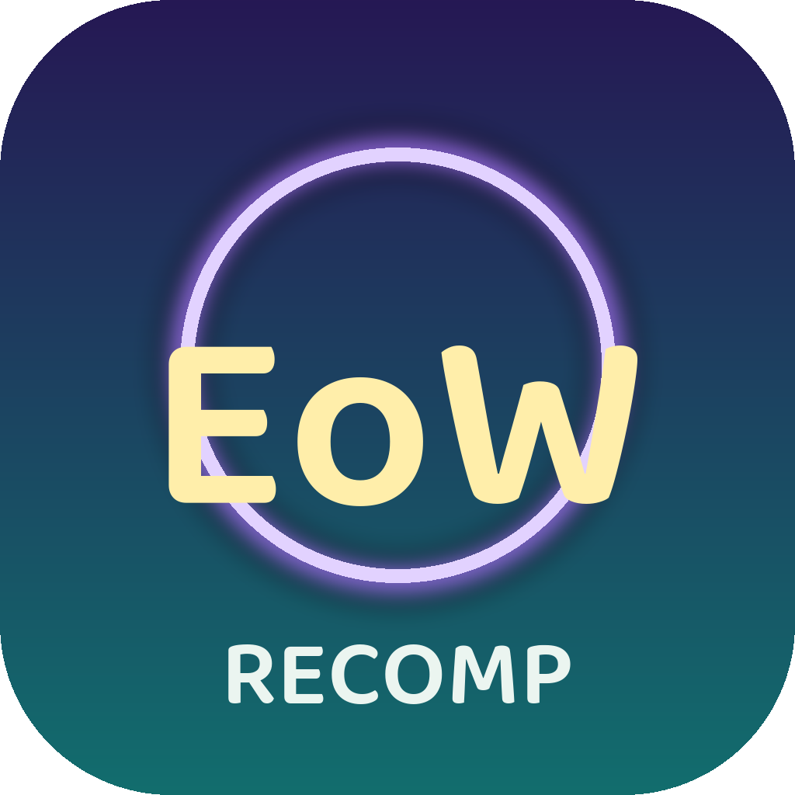

# EoWRecomp

  

<h1 align="center">EoWRecomp</h1>

  <b>Static recompilation of <i>The Legend of Zelda: Echoes of Wisdom</i> (Nintendo Switch, 2024)</b> 
  <b>Current development focus: Windows x64 + Vulkan</b>

  
  
  
  

---

EoWRecomp translates the game's ARM64 machine code into C ahead of time and recompiles it for the host PC. Its runtime replaces the Switch operating-system services used by the game and implements the NVN graphics API on top of Vulkan. It is based on [LAS Recomp](https://github.com/peiikai/LASRecomp).

> [!IMPORTANT]
> **Windows is the active testing and optimization target.** The results below come from testing on Windows 10 with a Xeon E5-2650 v4, Radeon RX 580 8 GB, 16 GB RAM and Vulkan. The project is in beta: most of the world renders, but a few visual effects (notably the void rifts) are still incomplete.

> [!WARNING]
> **No game files are included.** You must provide your own legally obtained copy of *The Legend of Zelda: Echoes of Wisdom* v1.0.0 (title ID `01008CF01BAAC000`) and your own `prod.keys`. The repository does not provide game files, keys, or instructions for obtaining them.

## Windows progress

<b>Windows x64 — Radeon RX 580 / Vulkan</b>

The Windows build now reaches in-game rendering. The game code is generated and compiled locally, the runtime loads the game modules, reads RomFS directly from the user's XCI package, and initializes Vulkan and audio.

| Area | Current result |
|---|---|
| Windows x64 | GitHub Actions build; the artifact is a ready-to-run folder |
| Game setup | XCI and user's `prod.keys` detected |
| Game code | 4 modules; 296,677 functions compiled into `eowgame.dll` |
| Runtime | All 4 modules load; SDK boot succeeds |
| Game data | RomFS read directly from XCI — 10,963 files |
| Graphics | Vulkan; tested swapchain at 1280×720 |
| Performance | **39–56 FPS** in recent Windows captures (Xeon E5-2650 v4, RX 580 8 GB, 16 GB RAM). Test observations, not a benchmark. |
| Compute | SUST storage-image support and compute dispatch handling have been implemented; continued validation is in progress. |

### Confirmed working in game (Windows / Radeon RX 580 / Vulkan)

These were checked by running the game and looking at screenshots and logs, not only by CI:

- **Vegetation and trees.** The game culls and draws vegetation on the GPU (compute shaders plus `DrawElementsIndirect`). Three fixes were needed:
  `nvnCommandBufferClearBuffer` (the culling counters were never reset), execution of the indirect draw/dispatch commands, and correct Maxwell
  lane operations for AMD wave64 GPUs (real lane IDs and lane masks, with ballot/vote/shuffle kept inside a 32-lane half so they behave like a
  Switch warp). Trees now render.
- **HUD hearts.** The heart texture is an RGB565 image whose alpha lives in the R channel; it is now decoded accordingly (no more opaque square).
- **Stretched light beams** are fixed.
- **Stencil reads.** Fragment shaders that sample the *stencil* aspect of a depth-stencil texture (NVN depth-stencil mode `STENCIL`) now get a real
  integer sampler (`usampler2D`, raw bits) instead of a float depth sample. This turned the void rift's dashed purple lines into continuous glowing
  edges. Covered by `tools/test_stencil.sh`.
- **Window/package polish:** the program icon is embedded in the `.exe`, and the CI artifact is a single ready-to-run folder.

### Known issues and work in progress

- **Void rifts (the purple tears near Suthorn Forest) are not finished.** Edges glow correctly, but the dark void fill does not show in normal
  frames. It *does* show in the passes saved by the F9 debug capture (`build/pass_*.png`), and the stencil contents are correct in that frame, so
  the problem is something that differs between a normal frame and a frame where every pass is flushed (ordering / timing of guest memory read by
  the GPU is the main suspect). Debug switches for this: `EOWRECOMP_FLUSH_PASSES=1`, `EOWRECOMP_VK_COPY_OPT=0`, `EOWRECOMP_NO_SNAPSHOT_REUSE=1`.
- **Performance is 39–56 FPS** on the test PC. The main known cost is that GPU-driven draw arguments are read back on the CPU after a flush
  (about 3 flushes per frame). The planned fix is to issue `vkCmdDrawIndexedIndirect` straight from the GPU buffer.
- **Intermittent freezes.** Most likely a lost wake-up in the simulated Horizon kernel (threads/synchronization). The watchdog's auto-unstick is a
  mitigation, not the root-cause fix.
- Some character models/skinning and a few visual effects can still look wrong.
- Only the **Vulkan** backend on **Windows** has been tested for the recent changes. The Metal backend and macOS/Android paths inherited from
  LAS Recomp have not been re-checked.

See [docs/STATUS.md](docs/STATUS.md) for the detailed technical log, test observations, logs, open bugs and next steps.

## Windows build

The repository includes a Windows x64 GitHub Actions workflow:

- Open the repository's **Actions** tab.
- Select the Windows build workflow and run it, or push a change that triggers it.
- Download the `EoWRecomp-windows-x64` artifact from a successful workflow run. GitHub delivers it as one ZIP containing the `EoWRecomp`
  folder; extract it and run `eowrecomp.exe`. The first launch generates and compiles the game code from your own files (about 30 minutes, once).
- Logs go to `eowrecomp.log` next to the `.exe`. Attach it when reporting a problem.

The package contains the application and build tools, but **does not contain game data**. The game code is generated and compiled on the user's PC from their own game package.

For build details, see the scripts under `tools/windows/` and the workflow at `.github/workflows/build-windows.yml`.

## How it works

- **Recompiler** (`tools/`): analyzes the game's ARM64 modules, resolves functions and jump tables, and generates C code.
- **Runtime** (`runtime/`): implements the Horizon services used by the game, including threads, synchronization, filesystem, input and audio.
- **Graphics**: reimplements NVN on Vulkan and translates Maxwell GPU shaders to GLSL.
- **Game package reader** (`runtime/nxpkg.c`): reads NSP/XCI/NCA packages using the user's keys. The RomFS can be read directly from the package instead of requiring a second multi-gigabyte copy.

## Release status: handing the project over

This is **beta 1**: a starting point for developers, not a finished game. The game boots, renders most of the world and is playable on the
test PC, with the open issues listed above. Everything needed to continue is in the repository:

- `docs/STATUS.md` is the detailed engineering log (in Portuguese): what works, what broke, hypotheses ruled out, and next steps.
- `CLAUDE.md` holds the project rules (no Nintendo files in the repo, never edit `generated/` by hand, every patch checks the original
  instruction word, a fix counts only once seen working).
- Tests live in `tools/` (`test_translate`, `test_shaders`, `test_simd`, `test_lift`, `test_lane.sh`, `test_stencil.sh`).
- **F9 debug capture:** press F9 in game to save the next frame's render passes (`build/pass_*.png`), the draw log, and, with
  `EOWRECOMP_SAVE_MSL=1`, the translated GLSL in `build/shaders`. This is how the rift and vegetation bugs were found.
- Debug switches all start with `EOWRECOMP_` (search `getenv("EOWRECOMP_` in `runtime/`).

Suggested next steps for contributors: finish the rift fill, move indirect draw arguments to the GPU, find the freeze's root cause, then
validate the Metal backend.

## Development status

See **[docs/STATUS.md](docs/STATUS.md)** for the detailed technical log:
- Windows test results and performance observations
- Vulkan/Radeon shader and pipeline investigations
- SUST and compute-shader progress
- Remaining graphics bugs and diagnostic instructions

## Credits

- **[EoWRecomp original project](https://github.com/Nycolazs/EoWRecomp)** by **Nycolazs** — original project and foundation this fork builds upon.
- **[LAS Recomp](https://github.com/peiikai/LASRecomp)** by Peiikai and contributors — the foundation for the recompiler, runtime, NVN implementation, Maxwell shader translator and Vulkan renderer.
- [SDL 3](https://libsdl.org), [FFmpeg](https://ffmpeg.org), [Dear ImGui](https://github.com/ocornut/imgui), [Vulkan](https://www.vulkan.org), [volk](https://github.com/zeux/volk), [Vulkan Memory Allocator](https://github.com/GPUOpen-LibrariesAndSDKs/VulkanMemoryAllocator), [shaderc](https://github.com/google/shaderc), [SMAA](https://github.com/iryoku/smaa) and [AMD FidelityFX FSR 1](https://github.com/GPUOpen-Effects/FidelityFX-FSR).
- Documentation and research references: [Switchbrew](https://switchbrew.org), [envytools](https://github.com/envytools/envytools), and the instruction decoders of Ryujinx and yuzu.

This project is developed with AI assistance from [Claude](https://www.anthropic.com/claude) (Anthropic), under human direction and testing. Commits made with Claude carry a `Co-Authored-By` trailer.

## Legal

EoWRecomp is an independent fan project and is not affiliated with, endorsed by, or sponsored by Nintendo. *The Legend of Zelda* and *Echoes of Wisdom* are trademarks of Nintendo. No game files, game code, assets or keys are included. You must provide your own legally obtained copy of the game.

## License

EoWRecomp's original code is licensed under MIT. Third-party components retain their respective licenses. This license grants no rights to Nintendo's game or other copyrighted content.
