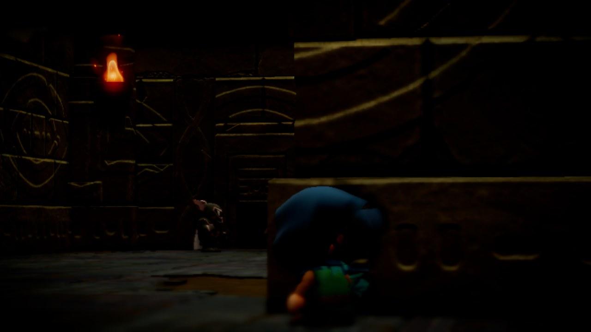
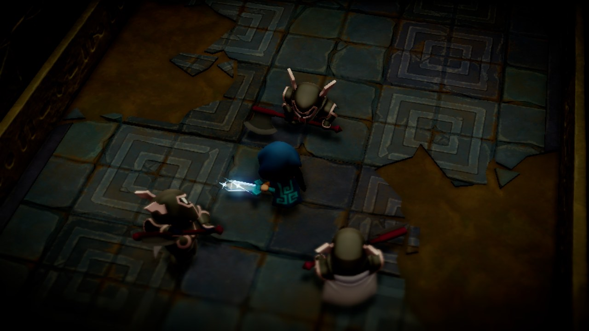
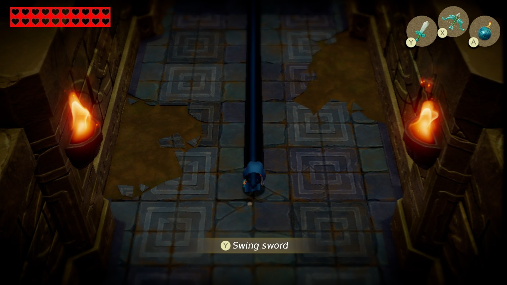
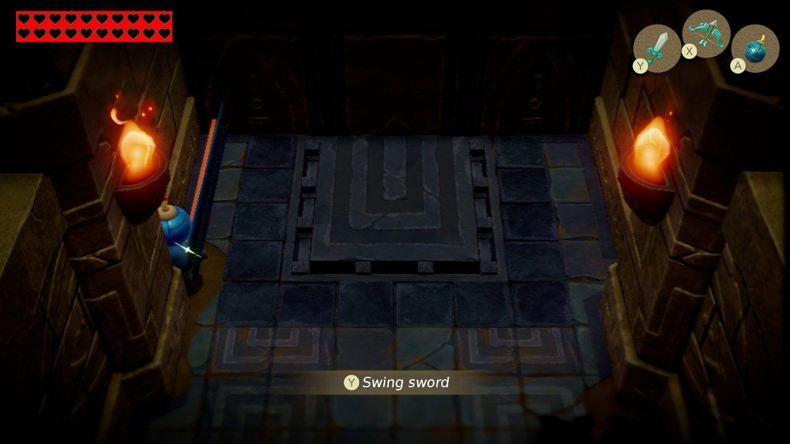

# EoWRecomp

  

<h1 align="center">EoWRecomp</h1>

  <b>Static recompilation of <i>The Legend of Zelda: Echoes of Wisdom</i> (Nintendo Switch, 2024)</b> 
  <b>Current development focus: Windows x64 + Vulkan</b>

  
  
  
  

---

EoWRecomp translates the game's ARM64 machine code into C ahead of time and recompiles it for the host PC. Its runtime replaces the Switch operating-system services used by the game and implements the NVN graphics API on top of Vulkan. It is based on [LAS Recomp](https://github.com/peiikai/LASRecomp).

> [!IMPORTANT]
> **Windows is the active testing and optimization target.** The results below come from testing on Windows 10 with a Xeon E5-2650 v4, Radeon RX 580 8 GB, 16 GB RAM and Vulkan. The project is still in development: some character rendering and visual effects remain incorrect.

> [!WARNING]
> **No game files are included.** You must provide your own legally obtained copy of *The Legend of Zelda: Echoes of Wisdom* v1.0.0 (title ID `01008CF01BAAC000`) and your own `prod.keys`. The repository does not provide game files, keys, or instructions for obtaining them.

## Windows progress

<b>Verified on Windows — Radeon RX 580</b>

The Windows build has moved beyond simply opening the application. The game code is generated and compiled locally, the runtime loads the game modules, reads the RomFS directly from the XCI package, initializes Vulkan and audio, and reaches in-game rendering.

| Area | Current result |
|---|---|
| Windows x64 build | Build and packaging workflow available through GitHub Actions |
| Game setup | XCI and `prod.keys` detected successfully |
| Game code | 4 modules generated; 296,677 functions compiled into `eowgame.dll` |
| Runtime | All 4 modules load; SDK boot succeeds |
| Game data | RomFS read directly from XCI — 10,963 files |
| Graphics | Vulkan swapchain at 1280×720 |
| Performance | **52 FPS** in the user capture, in **Hyrule Castle Town** (Windows 10, RX 580) |
| Compute shaders | **SUST storage-image path working; 0 compute dispatches skipped** in the latest test |
| Audio and input | Audren initializes; XInput detected |

### Graphics work completed

- Fixed a Windows/Radeon pipeline-build bottleneck caused by BRX shader translation generating an unnecessarily large GLSL dispatcher. The translator now labels only actual jump-table targets.
- Added support for Maxwell **SUST** compute image stores and Vulkan storage-image binding.
- Corrected SUST image-handle lookup for driver handle tables in constant-buffer banks 0 and 2.
- Updated storage-image views to respect each handle's mip level and array layer.
- Fixed Windows screenshot/debug output so the destination directory is created when it does not exist.
- Added diagnostics for vertex streams and vertex-shader constant buffers to investigate remaining character-skinning issues.

### Known issues

- Link and Zelda can still appear stretched during gameplay; some cutscenes render normally.
- Heart containers and some HUD elements still have incorrect colors/alpha.
- Some visual effects and rendering details remain unfinished.
- The latest SUST view change and some diagnostic paths still need further validation in-game.

These results are being tracked in the detailed [development status](docs/STATUS.md), including test observations, logs, open bugs and next steps.

## Screenshots

The screenshots currently in the repository document earlier Linux/Vulkan test sessions; they are not presented as captures of the latest Windows build.

| | |
|---|---|
|  |  |
|  |  |

## Windows build

The repository includes a Windows x64 GitHub Actions workflow:

- Open the repository's **Actions** tab.
- Select the Windows build workflow and run it, or push a change that triggers it.
- Download the `EoWRecomp-windows-x64` artifact from a successful workflow run.

The package contains the application and build tools, but **does not contain game data**. The game code is generated and compiled on the user's PC from their own game package.

For build details, see the scripts under `tools/windows/` and the workflow at `.github/workflows/build-windows.yml`.

## How it works

- **Recompiler** (`tools/`): analyzes the game's ARM64 modules, resolves functions and jump tables, and generates C code.
- **Runtime** (`runtime/`): implements the Horizon services used by the game, including threads, synchronization, filesystem, input and audio.
- **Graphics**: reimplements NVN on Vulkan and translates Maxwell GPU shaders to GLSL.
- **Game package reader** (`runtime/nxpkg.c`): reads NSP/XCI/NCA packages using the user's keys. The RomFS can be read directly from the package instead of requiring a second multi-gigabyte copy.

## Development status

See **[docs/STATUS.md](docs/STATUS.md)** for the detailed technical log:
- Windows test results and performance observations
- Vulkan/Radeon shader and pipeline investigations
- SUST and compute-shader progress
- Remaining graphics bugs and diagnostic instructions

## Credits

- **[EoWRecomp original project](https://github.com/Nycolazs/EoWRecomp)** by **Nycolazs** — original project and foundation this fork builds upon.\n- **[LAS Recomp](https://github.com/peiikai/LASRecomp)** by Peiikai and contributors — the foundation for the recompiler, runtime, NVN implementation, Maxwell shader translator and Vulkan renderer.
- [SDL 3](https://libsdl.org), [FFmpeg](https://ffmpeg.org), [Dear ImGui](https://github.com/ocornut/imgui), [Vulkan](https://www.vulkan.org), [volk](https://github.com/zeux/volk), [Vulkan Memory Allocator](https://github.com/GPUOpen-LibrariesAndSDKs/VulkanMemoryAllocator), [shaderc](https://github.com/google/shaderc), [SMAA](https://github.com/iryoku/smaa) and [AMD FidelityFX FSR 1](https://github.com/GPUOpen-Effects/FidelityFX-FSR).
- Documentation and research references: [Switchbrew](https://switchbrew.org), [envytools](https://github.com/envytools/envytools), and the instruction decoders of Ryujinx and yuzu.

This project is developed with AI-assisted tools under human direction and testing.

## Legal

EoWRecomp is an independent fan project and is not affiliated with, endorsed by, or sponsored by Nintendo. *The Legend of Zelda* and *Echoes of Wisdom* are trademarks of Nintendo. No game files, game code, assets or keys are included. You must provide your own legally obtained copy of the game.

## License

EoWRecomp's original code is licensed under MIT. Third-party components retain their respective licenses. This license grants no rights to Nintendo's game or other copyrighted content.
