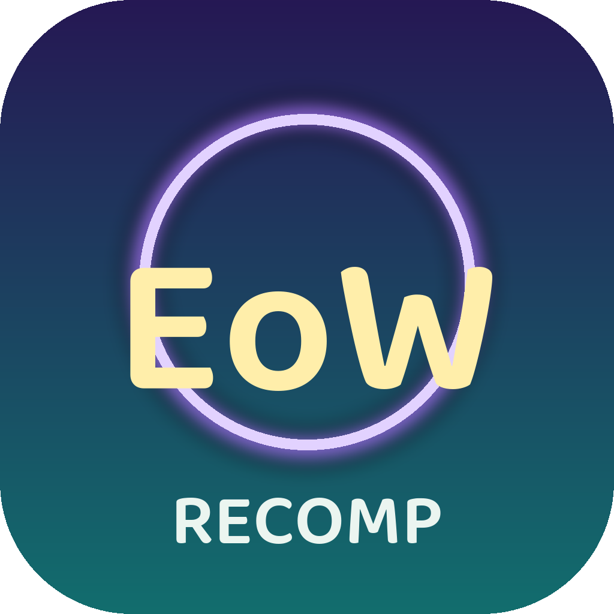

# EoWRecomp

  

<h1 align="center">EoWRecomp</h1>

  <b>Static recompilation of <i>The Legend of Zelda: Echoes of Wisdom</i> (Nintendo Switch, 2024)</b> 
  <b>Current development focus: Windows x64 + Vulkan</b>

  
  
  
  

---

EoWRecomp translates the game's ARM64 machine code into C ahead of time and recompiles it for the host PC. Its runtime replaces the Switch operating-system services used by the game and implements the NVN graphics API on top of Vulkan. It is based on [LAS Recomp](https://github.com/peiikai/LASRecomp).

> [!IMPORTANT]
> **Windows is the active testing and optimization target.** The results below come from testing on Windows 10 with a Xeon E5-2650 v4, Radeon RX 580 8 GB, 16 GB RAM and Vulkan. The project is still in development: some character rendering and visual effects remain incorrect.

> [!WARNING]
> **No game files are included.** You must provide your own legally obtained copy of *The Legend of Zelda: Echoes of Wisdom* v1.0.0 (title ID `01008CF01BAAC000`) and your own `prod.keys`. The repository does not provide game files, keys, or instructions for obtaining them.

## Windows progress

<b>Windows x64 — Radeon RX 580 / Vulkan</b>

The Windows build now reaches in-game rendering. The game code is generated and compiled locally, the runtime loads the game modules, reads RomFS directly from the user's XCI package, and initializes Vulkan and audio.

| Area | Current result |
|---|---|
| Windows x64 | GitHub Actions build and ZIP packaging available |
| Game setup | XCI and user's `prod.keys` detected |
| Game code | 4 modules; 296,677 functions compiled into `eowgame.dll` |
| Runtime | All 4 modules load; SDK boot succeeds |
| Game data | RomFS read directly from XCI — 10,963 files |
| Graphics | Vulkan; tested swapchain at 1280×720 |
| Performance | **52 FPS** in the available Windows capture at **Hyrule Castle Town** (Xeon E5-2650 v4, RX 580 8 GB, 16 GB RAM). This is a test observation, not a guaranteed benchmark. |
| Compute | SUST storage-image support and compute dispatch handling have been implemented; continued validation is in progress. |

### Recent graphics and runtime progress

- Implemented `nvnCommandBufferClearBuffer` using Vulkan buffer clearing for guest heap buffers. This addresses GPU-culling counters/indirect arguments that were not being reset between frames.
- Added execution of `DrawElementsIndirect`, `DrawArraysIndirect` and `DispatchComputeIndirect`, which the game uses for GPU-driven vegetation such as trees and grass.
- Added periodic diagnostics for indirect draw/dispatch counts, zero-instance draws and flushes.
- Corrected Maxwell lane operations for AMD wave64 GPUs: real lane IDs and lane masks, with ballot/vote/shuffle operations kept in 32-lane groups to match the Switch GPU's warp behavior. This is particularly relevant to the RX 580 (GCN).
- Improved the Windows watchdog and kernel synchronization handling to help diagnose and mitigate intermittent stalls.

**Validation note:** GitHub Actions runs for these recent changes completed successfully, but that confirms compilation and automated checks only. Vegetation rendering, frame pacing and freeze behavior still require confirmation in a real game session on Windows/Radeon.

### Known issues and work in progress

- Character skinning and some models can still appear stretched.
- Some HUD elements, heart transparency/colors and visual effects may still be incorrect.
- GPU-driven vegetation and the latest indirect-draw path need in-game verification.
- Intermittent stalls are being investigated; the watchdog is a mitigation, not a confirmed root-cause fix.

See [docs/STATUS.md](docs/STATUS.md) for the detailed technical log, test observations, logs, open bugs and next steps.

## Windows build

The repository includes a Windows x64 GitHub Actions workflow:

- Open the repository's **Actions** tab.
- Select the Windows build workflow and run it, or push a change that triggers it.
- Download the `EoWRecomp-windows-x64` artifact from a successful workflow run.

The package contains the application and build tools, but **does not contain game data**. The game code is generated and compiled on the user's PC from their own game package.

For build details, see the scripts under `tools/windows/` and the workflow at `.github/workflows/build-windows.yml`.

## How it works

- **Recompiler** (`tools/`): analyzes the game's ARM64 modules, resolves functions and jump tables, and generates C code.
- **Runtime** (`runtime/`): implements the Horizon services used by the game, including threads, synchronization, filesystem, input and audio.
- **Graphics**: reimplements NVN on Vulkan and translates Maxwell GPU shaders to GLSL.
- **Game package reader** (`runtime/nxpkg.c`): reads NSP/XCI/NCA packages using the user's keys. The RomFS can be read directly from the package instead of requiring a second multi-gigabyte copy.

## Latest development updates

The latest Windows/Vulkan work focuses on restoring GPU-driven vegetation and improving AMD compatibility:

- **Indirect GPU commands:** clear-buffer, indirect draw and indirect compute command handling.
- **AMD wave64 compatibility:** lane ID/mask and 32-lane ballot/vote/shuffle semantics for GCN GPUs.
- **Diagnostics and stability:** indirect-draw statistics and watchdog improvements for intermittent stalls.

The corresponding GitHub Actions builds (#62–#66) completed successfully. These results do not replace in-game testing; the rendering and stability changes are still awaiting confirmation on the target PC.

## Development status

See **[docs/STATUS.md](docs/STATUS.md)** for the detailed technical log:
- Windows test results and performance observations
- Vulkan/Radeon shader and pipeline investigations
- SUST and compute-shader progress
- Remaining graphics bugs and diagnostic instructions

## Credits

- **[EoWRecomp original project](https://github.com/Nycolazs/EoWRecomp)** by **Nycolazs** — original project and foundation this fork builds upon.
- **[LAS Recomp](https://github.com/peiikai/LASRecomp)** by Peiikai and contributors — the foundation for the recompiler, runtime, NVN implementation, Maxwell shader translator and Vulkan renderer.
- [SDL 3](https://libsdl.org), [FFmpeg](https://ffmpeg.org), [Dear ImGui](https://github.com/ocornut/imgui), [Vulkan](https://www.vulkan.org), [volk](https://github.com/zeux/volk), [Vulkan Memory Allocator](https://github.com/GPUOpen-LibrariesAndSDKs/VulkanMemoryAllocator), [shaderc](https://github.com/google/shaderc), [SMAA](https://github.com/iryoku/smaa) and [AMD FidelityFX FSR 1](https://github.com/GPUOpen-Effects/FidelityFX-FSR).
- Documentation and research references: [Switchbrew](https://switchbrew.org), [envytools](https://github.com/envytools/envytools), and the instruction decoders of Ryujinx and yuzu.

This project is developed with AI-assisted tools under human direction and testing.

## Legal

EoWRecomp is an independent fan project and is not affiliated with, endorsed by, or sponsored by Nintendo. *The Legend of Zelda* and *Echoes of Wisdom* are trademarks of Nintendo. No game files, game code, assets or keys are included. You must provide your own legally obtained copy of the game.

## License

EoWRecomp's original code is licensed under MIT. Third-party components retain their respective licenses. This license grants no rights to Nintendo's game or other copyrighted content.
