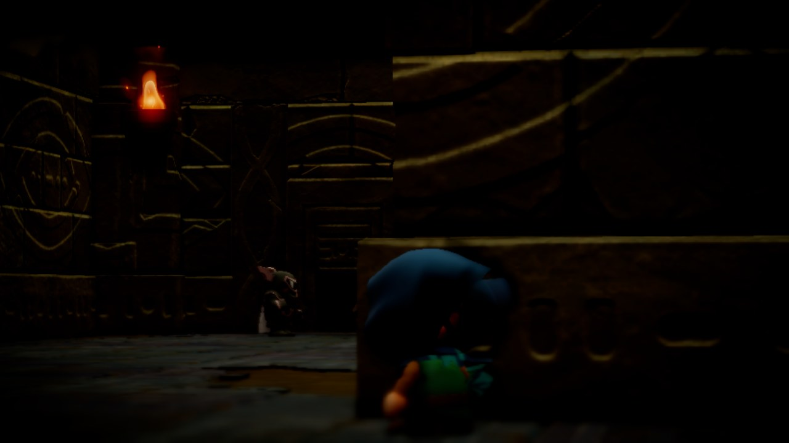
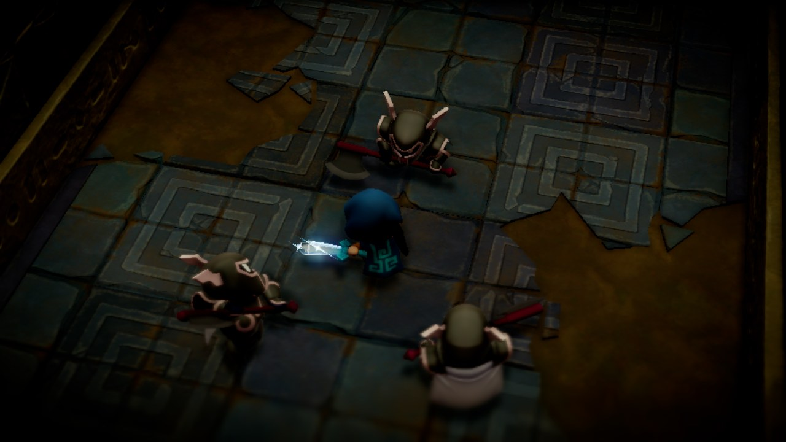
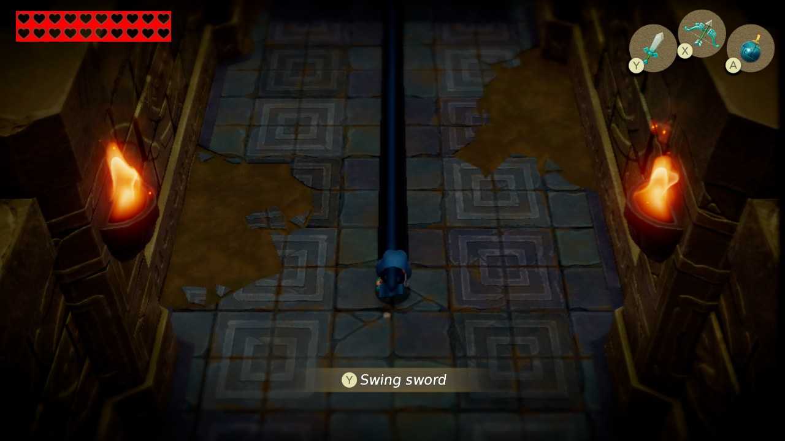
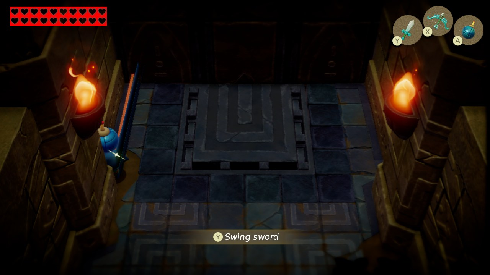

# EoWRecomp

**EoWRecomp** is a work-in-progress **static recompilation** of *The Legend of Zelda: Echoes of Wisdom* (Nintendo
Switch, 2024) into a native PC program. It is **not an emulator**: the game's ARM64 code is translated to C ahead of
time and compiled for x86-64, and a runtime replaces the Switch's operating system (Horizon) and its graphics API
(NVN), drawing with Vulkan.

> [!WARNING]
> **Early development - not playable yet.** The game boots, plays its opening and the first controllable scene with
> working input, but performance, audio, saves and many effects are still being worked on. There are no builds to
> download. See [docs/STATUS.md](docs/STATUS.md) for the exact state.

> [!NOTE]
> **No game files are included**, and none ever will be. EoWRecomp needs your own legally obtained copy of
> *Echoes of Wisdom* **v1.0.0** (title 01008CF01BAAC000, no updates) and the keys from your own console. Instructions
> on how to obtain these files will **not** be provided.

## Screenshots

Native Linux build, Vulkan on an Intel Iris Xe laptop GPU, 1280x720. These are frames of the recompiled game itself,
captured by the runtime.

| | |
|---|---|
|  |  |
|  |  |

## Progress

| Milestone | State |
|---|---|
| M1 - all game code recompiles to C (4 modules, ~296,000 functions, 0 unsupported instructions) | ✅ done |
| M2 - the runtime links and boots into the game | ✅ done |
| M3 - first frame presented | ✅ done |
| M4 - first correct image | ✅ done (the opening) |
| M5 - title screen, audio, input, new game, first playable scene | 🔶 input works, first scene reachable; audio not yet verified |
| M6 - playable start to finish, saves | ⬜ |
| M7 - PC features: resolution, free aspect ratio, unlocked frame rate, remapping, Xbox / PlayStation icons | ⬜ |

Known problems right now: low GPU performance (some translated shaders are still very expensive on integrated GPUs),
a dark rendering artifact following Link in the opening, two compute shaders not translated yet, and the Windows build
is compiled from Linux but has not been run on Windows yet.

## How it works

- **Recompiler** (`tools/`, Python): reads the ExeFS modules (`main`, `sdk`, `subsdk0` - the GLSL compiler,
  `subsdk1` - multimedia), finds every function (`.eh_frame`, symbols, relocations, call targets), resolves jump tables
  by running the code in [Unicorn](https://www.unicorn-engine.org), and emits C for each function. Integer and memory
  instructions become C; FP/SIMD becomes portable C (x86-64) or inline assembly (ARM64 hosts). ARMv8.1 atomics and
  128-bit exclusive pairs used by the SDK 16.2 are supported and tested against Unicorn.
- **Runtime** (`runtime/`, C): a small Horizon kernel (threads, mutexes and condition variables with Horizon
  semantics, memory, events), IPC with the system services the game uses (file system, input, audio renderer,
  applet manager, time, settings...), and NVN reimplemented on top of Vulkan. The game's Maxwell GPU shaders are
  translated to GLSL at run time and compiled to SPIR-V.
- **Extraction** (`tools/nca_extract.py`): reads ExeFS and RomFS straight from the program NCA of your own dump,
  including the compressed RomFS this game uses (which hactool can't read).

Everything was built on top of [LAS Recomp](https://github.com/peiikai/LASRecomp), the same kind of project for
*Link's Awakening* (also by Grezzo). [docs/ARCHITECTURE.md](docs/ARCHITECTURE.md) explains the pipeline and what was
reused, adapted or written new.

## Building (Linux, for developers)

This is for people who want to work on it - there is nothing to play yet.

1. Python tools: `python3 -m venv tools/venv && tools/venv/bin/pip install capstone==5.0.9 unicorn==2.1.4 lz4 cryptography pillow`
2. Compiler and libraries without root: `tools/linux/dev_deps.sh` (zig 0.17 as clang + lld, and the SDL3 / Vulkan /
   shaderc / FFmpeg / VMA development packages fetched with `apt-get download`, Ubuntu / Debian).
3. Your own game files: `hactool` to get the NCAs out of your XCI, then
   `tools/venv/bin/python tools/nca_extract.py <your prod.keys> <program NCA> extracted --romfs-image`
4. `make gen` (recompiles the game code, ~1.5 minutes), then
   `PATH=$PWD/build/bin:$PATH make -j$(nproc) DEPS=$PWD/build/deps-linux GENARCH=-mcpu=x86_64_v3`
   (the first build of the game code takes about an hour).
5. `tools/run.sh` (headless test run with a log), or `SHOW=1 tools/run.sh` to see the window.

Windows: `tools/windows/fetch_deps.sh` and `tools/windows/build.sh all` cross-compile `eowrecomp.exe` and
`eowgame.dll` from Linux (untested on Windows so far).

## Credits

- **[LAS Recomp](https://github.com/peiikai/LASRecomp)** by Peiikai and its contributors - the base of this project
  (MIT). The recompiler, the Horizon runtime, the NVN implementation, the Maxwell shader translator and the Vulkan
  renderer all started there.
- [SDL 3](https://libsdl.org) (zlib), [FFmpeg](https://ffmpeg.org) (LGPL 2.1+, linked dynamically),
  [Dear ImGui](https://github.com/ocornut/imgui) (MIT),
  [Vulkan Memory Allocator](https://github.com/GPUOpen-LibrariesAndSDKs/VulkanMemoryAllocator) (MIT),
  [shaderc](https://github.com/google/shaderc) (Apache 2.0), [SMAA](https://github.com/iryoku/smaa) (MIT),
  [AMD FidelityFX Super Resolution 1](https://github.com/GPUOpen-Effects/FidelityFX-FSR) (MIT),
  [Baloo 2](https://github.com/EkType/Baloo2) font (SIL OFL 1.1)
- Build-time tools: [Capstone](https://www.capstone-engine.org) (BSD), [Unicorn](https://www.unicorn-engine.org)
  (GPL 2.0; Python bindings BSD), [python-lz4](https://github.com/python-lz4/python-lz4) (BSD),
  [cryptography](https://cryptography.io) (Apache 2.0 / BSD), [Zig](https://ziglang.org) as C compiler (MIT; LLVM:
  Apache 2.0 with LLVM exceptions)
- Documentation: [Switchbrew](https://switchbrew.org), [envytools](https://github.com/envytools/envytools),
  Atmosphère's kernel and file system sources, and the instruction decoders of Ryujinx and yuzu as references for
  Maxwell and Horizon behaviour.

This project is developed almost entirely with AI (Anthropic's Claude, through Claude Code), directed and tested by a
human - the same way as the project it is based on.

## Legal

EoWRecomp is a fan project. It is not affiliated with, endorsed by or sponsored by Nintendo. *The Legend of Zelda* and
*Echoes of Wisdom* are trademarks of Nintendo. No game files, game code, assets, keys or fonts are included - not in
this repository and not in any build. The screenshots above are captures of the running game, shown for documentation.
You must provide your own legally obtained copy of the game.

## License

EoWRecomp's own code is MIT licensed ([LICENSE](LICENSE), which keeps LAS Recomp's copyright notice). Third-party
components keep their own licenses, listed above. The license covers EoWRecomp's code only - it grants nothing for
Nintendo's game.
