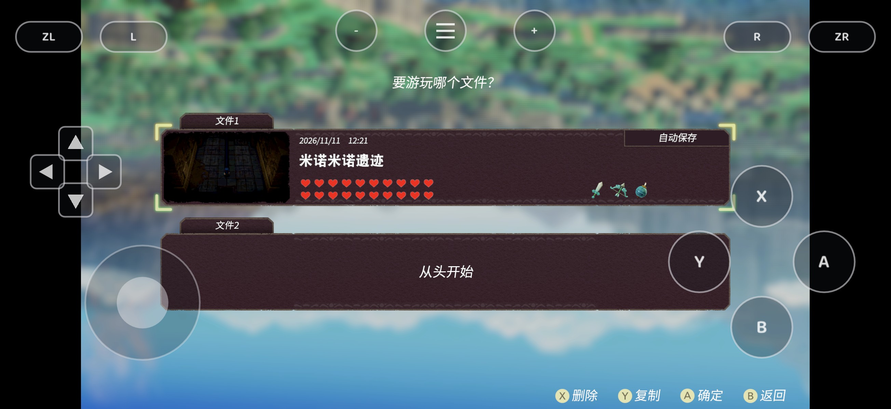
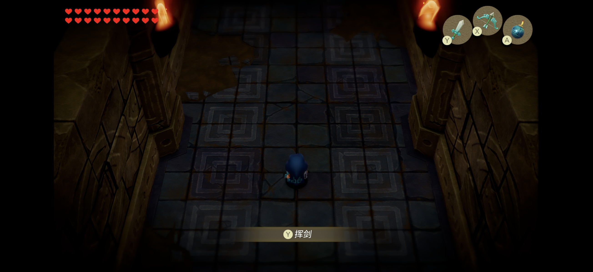

# Stock Adreno and Chinese text validation

Glyphs disappeared on **Adreno 840 / Android 17 / stock Vulkan 1.4.295**, while icons and the surrounding UI still rendered. Disabling `VK_EXT_external_memory_host` use in the Windows Vulkan reproduction produced the same missing caption. Font substitution alone did not resolve it.

## Changes in this contribution

- Glyph vertex shaders fetch per-character storage data with **LDG**. Without host-memory import the previous path bound zeros. Read-only graphics loads now consult the existing GMap address table; a per-draw/per-stage snapshot contains only valid bound NVN storage ranges, limited by **32 MiB and the device storage-buffer limit**. Native imported-heap reads and compute copy-back retain their existing behavior. This is not general mobile GPU-write fallback.
- Chinese settings serve **`zh-Hans` / `zh-Hant`**, accepting existing `zh-CN` / `zh-TW` configuration files. The old codes fell back to Japanese in the tested game. CRLF configurations and locale script/region forms are recognized.
- Chinese mode uses a renamed, openly licensed **static TrueType Noto Sans SC** fallback, preserving explicit-font and console-dump precedence. The source, SHA-256 and fontTools version are pinned; the [font license](../third_party/fonts/NotoSansSC/OFL.txt) is shipped in the APK. No console font is included.
- A mutex prevents concurrent font Address/Size requests from observing an unfinished load. This preserves the service's existing shared Standard fallback behavior across regional requests.

The open-font source/version and static TrueType conversion approach follows [S2Arm's font builder](https://github.com/jhaizhou-ops/S2Arm/blob/3fe7ea9d1df517cfc011667fcdc5818b79e2e226/pack/fonts/make_open_fonts.py). No S2Arm renderer was integrated.

## Tests

| Test | Observed result |
| --- | --- |
| `test_vk_gmem.c` | Production **vertex-stage** Maxwell translation, observed in a compute GPU probe without vertex inputs: zero native heap previously returned `00000000`; staged range returns `1234abcd`. Empty-map/native-heap control also returns `1234abcd`. |
| `test_shared_fonts.c` | Original second concurrent request could observe size 0; both threads now receive the same complete font. |
| `test_language.c` | Legacy/modern simplified/traditional codes, English, and CRLF passed (six configurations). |
| `test_cjk_font.py` | 19 prompt/UI characters have actual TrueType outlines; 30,890 mapped characters. Pinned rebuilds produced identical font bytes. |

Example commands on an x86-64 Linux host with Vulkan/shaderc development libraries:

```sh
cc -O2 tools/test_vk_gmem.c runtime/nvn/maxwell/translate.c -lvulkan -lshaderc_shared -o build/test_vk_gmem
cc -O2 -march=native -pthread -DEOW_RUNTIME tools/test_shared_fonts.c -o build/test_shared_fonts
cc -O2 -march=native -DEOW_RUNTIME tools/test_language.c -o build/test_language
build/test_vk_gmem
build/test_shared_fonts third_party/fonts/NotoSansSC/EowSansSC-Regular.ttf
printf 'language = zh-CN\n' > build/test_language.ini
build/test_language build/test_language.ini zh-Hans
python tools/test_cjk_font.py
```

Executed host checks used LLVM-MinGW / NVIDIA RTX 5060 Ti / Vulkan. Android compiled with NDK 28.1.13356709. The font builder requires `fonttools==4.67.0` and verifies downloaded open-font sources before conversion. Shared renderer changes were exercised through Vulkan; **Metal was not tested**.

## Device evidence and relation to other fixes

An integration APK loaded the original save, showed Chinese file-selection labels and the dungeon's **挥剑** caption, accepted touch movement and resumed after backgrounding. All four save files remained byte-identical to their pre-install backup. The Windows no-import full scene likewise changed from a missing caption to readable Chinese.

The device integration also contained equivalent fixes for the independent issues already proposed in **[#6 (RGB565 HUD)](https://github.com/Nycolazs/EoWRecomp/pull/6)**, **[#22 (Android startup)](https://github.com/Nycolazs/EoWRecomp/pull/22)** and **[#23 (LDC.64/skinning)](https://github.com/Nycolazs/EoWRecomp/pull/23)**. Those overlapping production fixes are deliberately left to those PRs. These screenshots document the combined validation, not a claim that this text-only contribution fixes every prologue issue by itself. The complete tested local integration is retained in the contributor's `fix/android-adreno-rendering` branch.





## Limits

- This main-based proposal offers a bounded read-only snapshot path for the current non-import renderer; it is not a coherence fix or validation of #22's AHardwareBuffer/BDA implementation. That implementation may need a different integration point. No Turnip comparison was performed.
- Opening scene/menu were checked, not a full playthrough or sustained performance benchmark. Existing unsupported compute instructions and general GPU-write fallback remain.
- The current FFmpeg file reader required the user's own video files to be materialized in their private game-data directory during testing. A virtual-RomFS FFmpeg reader is separate work, already addressed by #22. No videos, game binaries, generated code, keys, saves or personal APK are included here.
- Some Windows replays, including an original-font control, blocked in guest initialization. No fix for those waits is claimed. The documented full-scene no-import before/after comparison completed with a 3 ms pacing hook.
