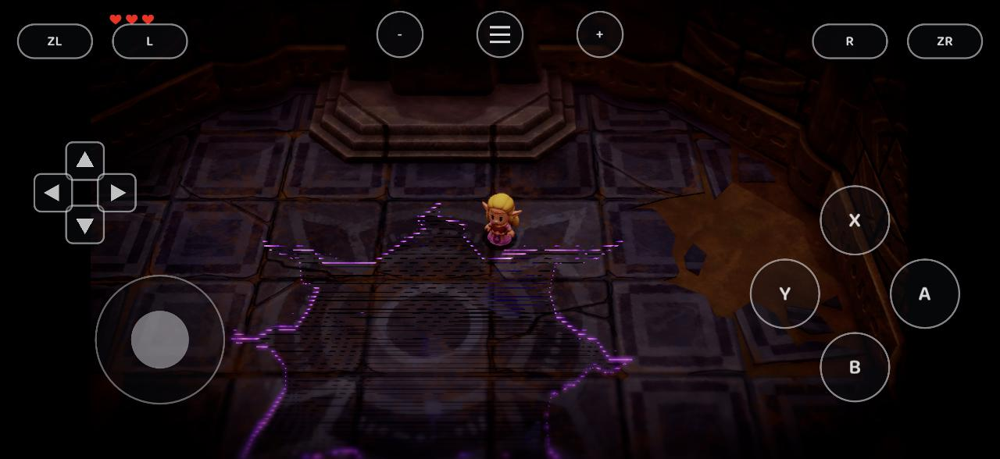
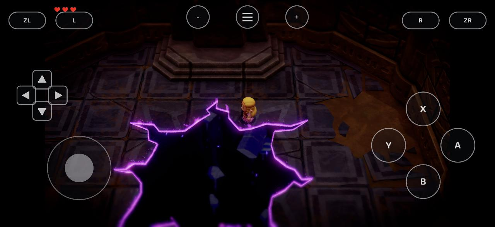

# Vulkan feedback stencil and no-import compute writes

## Reproduction and result

On stock Adreno 840 (Android 17, Vulkan 1.4.295), the post-rescue Zelda room rendered a rift as
purple/black horizontal stripes over an intact floor. With the fixes below, its black interior,
continuous purple edge and floating fragments appear correctly. The user confirmed the result,
and a cold reload with diagnostic environment settings removed retained it.

| Before | After |
| --- | --- |
|  |  |

These captures are from the [combined Android integration](https://github.com/c-hui/EoWRecomp/tree/e37f0bf694423b25eab9266930ef207707835d6d),
which also includes the other pending shader/text fixes. They are **not** proof that this
main-based follow-up alone fixes the entire prologue. No game assets, extracted shaders, keys,
saves, generated game code or APK are included.

## Causes and changes

1. **Missing compute write-back without host-memory import.** Stock Adreno lacks
   `VK_EXT_external_memory_host`. The preceding compute fast path required an imported heap;
   without it, global accesses used the zero buffer and stores never reached guest memory.
   The fallback now snapshots only the dispatch's bounded storage ranges into coherent transient
   storage. Each dispatch owns its input snapshot. Storing dispatches retire before only the
   original bound bytes are restored; aligned padding and merged gaps are not copied back.
   Shared guest snapshots are invalidated afterward. The imported-heap path keeps its existing
   behavior. The fallback uses the existing 32 MiB / device storage-range limit.
2. **Stencil bindings redirected to depth views.** The same depth/stencil attachment can be
   sampled as depth and stencil in one draw. Feedback replacement previously used the depth
   view for both, even when the original binding selected stencil. The rift cut-out shader's
   integer sampler then read the wrong aspect. Both new and reused snapshots now provide
   separate views and preserve the original binding's stencil selection. Their transfer-source
   usage also permits the existing debug readback. Original and copied depth dumps were
   byte-identical during diagnosis; corruption of the depth-copy data was ruled out.

This complements #25's read-only graphics fallback and #22/#23's shader, stencil and coherence
work. Their VMNMX/ATOM/lane-register, work-grid, movie, generator and Turnip changes are not
copied into this follow-up. In particular, correct stencil sampler translation still comes from
the existing stencil/shader work. The new code uses the current GMap path, without requiring
Turnip or AHardwareBuffer/BDA. Integrating #22's alternate heap path may need reconciliation.

## Focused validation

The tests were rebuilt from this isolated main-based branch with NDK 27.2.12479018, then run on
the same stock-driver phone:

- `test_vk_compute_copyback`: the empty-map control returns/copies back zero; the staged
  LDG/STG program returns and copies back `1234abcd`, preserving its input word.
- `test_vk_depth_copy`: all 1,376,320 depth/stencil texels survive combined and separate aspect
  copies, with and without attachment usage. Separate float-depth / uint-stencil sampling
  reports zero mismatches in all four variants.
- Android Vulkan `exec.c` passes the NDK syntax check against the repository SDL/Vulkan/VMA
  headers. The same changed renderer logic was built and exercised in the combined APK above.
- `git diff --check` passes.

The compute test exercises production Maxwell translation and Vulkan descriptor/dispatch/
readback behavior. It does not directly invoke the renderer's storage-range collection helper.
The depth test verifies copy/sampling semantics, not the production NVN binding selector; the
actual scene comparison above supplies that end-to-end evidence in the combined build.

After building the existing Android dependencies, a standalone test build can use:

```sh
# Set these to the existing NDK toolchain and build_deps.sh output.
NDK_BIN=/path/to/ndk/toolchains/llvm/prebuilt/linux-x86_64/bin
DEPS=/path/to/android/deps
TEST_OUT=$(mktemp -d)
"$NDK_BIN/aarch64-linux-android30-clang" -O2 -c runtime/nvn/maxwell/translate.c -o "$TEST_OUT/translate.o"
for test in compute_copyback depth_copy; do
    "$NDK_BIN/aarch64-linux-android30-clang" -O2 -I"$DEPS/include" \
        -c "tools/test_vk_$test.c" -o "$TEST_OUT/$test.o"
done
"$NDK_BIN/aarch64-linux-android30-clang++" "$TEST_OUT/compute_copyback.o" "$TEST_OUT/translate.o" \
    "$DEPS/lib/libshaderc_combined.a" -lvulkan -lm -o "$TEST_OUT/compute_copyback"
"$NDK_BIN/aarch64-linux-android30-clang++" "$TEST_OUT/depth_copy.o" \
    "$DEPS/lib/libshaderc_combined.a" -lvulkan -lm -o "$TEST_OUT/depth_copy"
# Push the two executables to /data/local/tmp, chmod +x, and run with adb shell.
# Remove those executables and TEST_OUT after testing.
```

Only Vulkan was tested. No Metal, desktop-driver, full-playthrough or sustained-performance
validation is claimed. The synchronous no-import copy-back adds waits and is a correctness
fallback, not an FPS optimization. General graphics-stage global-memory write-back and the
specific post-rescue movie transition remain outside this follow-up's verification.
